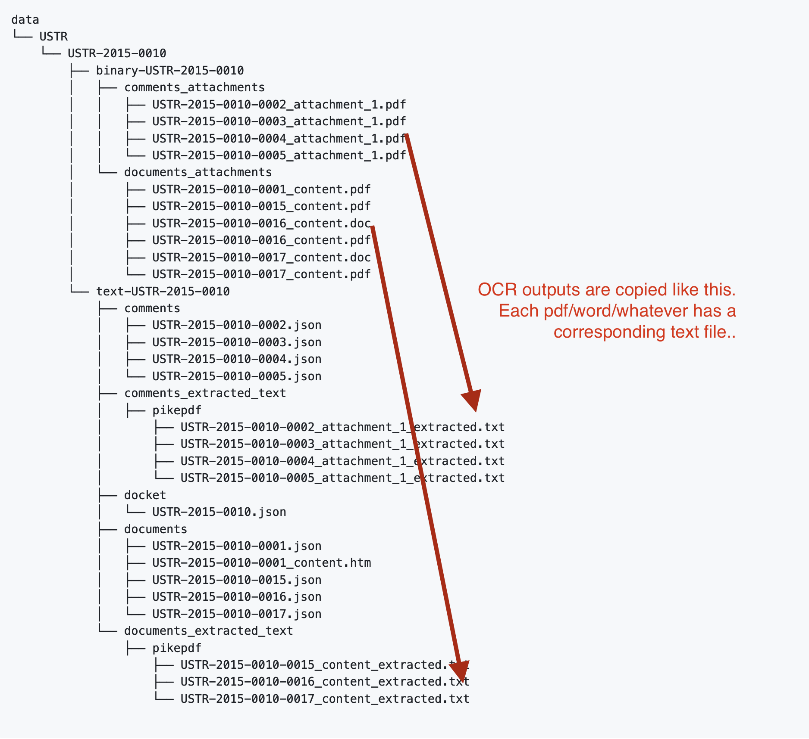

# Mirrulations Regulation Data

This repository turns bounded portions of the public
[Mirrulations](https://github.com/MoravianUniversity/mirrulations) corpus into
an auditable Markdown database. The ETL recovers document structure, annotates
citations and backward references, extracts regulatory issues, models public
comment topics, and produces a deterministic graph bundle for Neo4j.

Files and JSON sidecars under `data/markdown_db/` are the source of truth for
pipeline results. Rendered views and the local Neo4j database are rebuildable
projections.

## Quick start

The full processing order is:

1. Download and verify a bounded Mirrulations docket.
2. Create Stage 1 semantic Markdown and Stage 2 citation enrichment.
3. Run Stage 3 structure discovery and Stage 4 exact-reference linking.
4. Extract regulatory issues with LangExtract and model comment topics with
   CorEx.
5. Render Stage 5 topic-enriched Markdown, browse it locally, and optionally
   import its deterministic graph bundle into Neo4j.

Create the Python environment and a local configuration file:

```shell
python3 -m venv .venv
.venv/bin/python -m pip install --upgrade pip
.venv/bin/python -m pip install -r requirements.txt
cp example.env .env
```

Python 3 and `rclone` are required. Docker with Compose is optional and is used
only for Neo4j. Edit the ignored `.env`, but never commit it. At minimum,
configure separate, non-overlapping roots:

```dotenv
MIRRULATIONS_DESTINATION_PATH=/absolute/path/to/mirrulations-source
MARKDOWN_DB_PATH=./data/markdown_db
RCLONE_CONFIG_FILE=/absolute/path/to/rclone.config
```

Set only the credentials needed by the selected stages: `OPENAI_API_KEY`,
`ANTHROPIC_API_KEY`, `GEMINI_API_KEY`, or `REGULATIONS_GOV_API_KEY`. Production
topic extraction accepts `LANGEXTRACT_API_KEY` or `GEMINI_API_KEY`. Never put
credentials in versioned YAML files. The pipeline never edits `.env`.

## Permanent documentation

- [Corrected Mirrulations storage and JSON guide](MirrulationsStructureCorrected.md)
- [Exact pinned upstream structure document](MirrulationsStructureUpstream.md)
- [Regulatory resource traversal guide](MirrulationsRegulatoryDocumentStructure.md)
- [Regulations.gov process metadata and SORNs](RegulationsGovRegulatoryProcessMetadata.md)
- [Generated Markdown database contract](RichDocumentStructure.md)
- [Checked-in API examples and simple downloader](examples/regulation_gov_results/)
- [Official Reg Map PDF](https://www.reginfo.gov/public/reginfo/Regmap/REG_MAP_2020.pdf)

These are the stable entry points for humans and automated readers. Generated
files under `data/` remain reproducible evidence rather than primary
documentation.

## S3 Access
The Mirrulations project publishes its results at the following S3 Bucket. 

```
s3://mirrulations
```

Mirrulations uses 

## How to download
The simplest way to download the data, is to use rclone. 
We have written [helper scripts that automate the rclone commands](scripts/rclone/).

Using the script it is simple to download data by year, by Federal agency, and to decide to download the raw text only, or to download both the raw text and the originals (generally pdfs and word documents).

## Markdown enrichment

The Markdown pipeline begins with an exact, bounded Mirrulations acquisition.
It includes originals for structure recovery. After successful remote
verification, JSON may be pretty-printed in place with pre- and post-formatting
hashes recorded. Configure separate source and output roots in your environment:

```dotenv
MIRRULATIONS_DESTINATION_PATH=/absolute/path/to/mirrulations-source
MARKDOWN_DB_PATH=./data/markdown_db/
```

`MARKDOWN_DB_PATH` defaults to `./data/markdown_db/`. The source and output
roots must not overlap. The pipeline never edits an actual `.env` file.
Non-JSON source objects remain unchanged.

For the manual development-validation docket, acquire the text corpus with:

```shell
python3 scripts/rclone/mirrulations_downloader.py \
  --docket CMS-2026-1255
```

Verify the mirror and create the initial and citation-enriched Markdown
projections with:

```shell
python3 scripts/markdown_enrichment.py \
  --source-root /absolute/path/to/mirrulations-source \
  --markdown-db ./data/markdown_db \
  --docket CMS-2026-1255 \
  --verify \
  --rclone-config /absolute/path/to/rclone.config
```

Add `--normalize-json` on the first run after a fresh verification to
pretty-print downloaded JSON in place. The pipeline records original and
normalized hashes. This is a one-time transformation per verified acquisition;
use a fresh verified acquisition before normalizing again.

Citation enrichment paces official-page title requests. Configure requests per
second with a positive floating-point value:

```shell
--title-requests-per-second 2
```

Values below one are supported: `0.5` means one request every two seconds and
`0.3` means one request about every 3.33 seconds. Cached successes and failures
are not requested again. Use `--refresh-reference-titles` to retry cached
failures. `--maximum-title-fetches` remains available as an optional emergency
cap but has no default limit.

Readable output is stored in immutable numbered projections:

```text
data/markdown_db/
  stage001_initial_markdown_mirror/
  stage002_addition_of_citations/
  stage003_structure_discovery/
  stage004_backward_reference_links/
  stage005_topic_enrichment/
  metadata/
```

The current implementation records unavailable external citation libraries in
`metadata/runs/adapter_status.json`. It does not silently label built-in
explicit USC/CFR detection as eyecite, LexNLP, or unitedstates/citation.

The Markdown database includes three global metadata files:

```text
metadata/citation_reverse_lookup.md
metadata/reference_friendly_names.md
metadata/document_friendly_names.md
```

The editable friendly-name columns start blank. Enter a nonblank value to
override the official reference title or generated document name. Reruns retain
those edits. Citation reverse lookup headings and links use the edited value
when present and otherwise use the official/generated value.

## Local browsers and Neo4j graph

The file-backed graph projection uses a local Neo4j Docker container. Files
remain authoritative; Neo4j is disposable and rebuildable. Set a local
`NEO4J_PASSWORD` without committing it. If the default ports conflict with
other services, choose alternate host ports before starting Neo4j:

```shell
export NEO4J_PASSWORD='choose-a-local-password'
export NEO4J_BROWSER_PORT=17474
export NEO4J_BOLT_PORT=17687
export NEO4J_URI=bolt://127.0.0.1:17687
docker compose up -d neo4j
docker compose ps
```

Validate a generated graph bundle before import:

```shell
.venv/bin/python scripts/neo4j_graph.py validate \
  --bundle data/markdown_db/metadata/topic_graph/graph_bundle.json
```

Import the validated bundle idempotently:

```shell
.venv/bin/python scripts/neo4j_graph.py import \
  --uri bolt://127.0.0.1:17687 \
  --bundle data/markdown_db/metadata/topic_graph/graph_bundle.json
```

Neo4j Browser is available at <http://127.0.0.1:7474> by default, or at
<http://127.0.0.1:17474> with the alternate port above. `NEO4J_URI`,
`NEO4J_USER`, and `NEO4J_PASSWORD` provide importer defaults. Deterministic node
and relationship keys make repeated imports idempotent. Comment graph records
retain the identifiers needed to link to the existing comment browser
submission, representation, stage, and block-anchor detail pages. Start that
browser separately with:

```shell
.venv/bin/python scripts/comment_browser.py start \
  --markdown-db data/markdown_db
```

Open <http://127.0.0.1:8765/comments/>. The browser automatically selects Stage
5 when present. Keep `COMMENT_BROWSER_BASE_URL` aligned with the browser address
before graph generation. To discard only this Compose project's graph volume,
run `docker compose down -v`; this permanently removes the local projection.

### Topic extraction and graph generation

Install the pinned LangExtract and CorEx dependencies from `requirements.txt`.
For production regulatory extraction, set `LANGEXTRACT_API_KEY` or
`GEMINI_API_KEY` in the process environment or local ignored `.env`, then run:

```shell
.venv/bin/python scripts/topic_pipeline.py \
  --markdown-db data/markdown_db \
  --extraction-mode langextract \
  --output-root data/markdown_db/metadata/topic_graph \
  --model gemini-3.8-flash \
  --topic-count 20 \
  --assignment-threshold 0.9 \
  --maximum-topics-per-block 3
```

The command fails before extraction when no credential is available; it never
silently substitutes generated regulatory issues. For offline development, the
explicit `rule-based` mode uses proposed-rule section headings as transparent
agency topic anchors while still fitting the real CorEx model over all eligible
comment blocks:

```shell
.venv/bin/python scripts/topic_pipeline.py \
  --extraction-mode rule-based \
  --topic-count 20 \
  --assignment-threshold 0.9
```

Outputs are written beneath `metadata/topic_graph/` and include the run
manifest, regulatory issues, topic candidates, accepted assignments, maintained
Markdown views, and the deterministic `graph_bundle.json`. Import that bundle
with `scripts/neo4j_graph.py` as shown above. LangExtract writes the atomic
`langextract_checkpoint.json`, so an interrupted extraction resumes without
repeating completed calls. CorEx fits topics across all eligible comment blocks,
tracks exact duplicates, and caps accepted assignments per block. Topic-enriched
documents are rendered under `stage005_topic_enrichment/`.

## Structure discovery

Stage 3 reads immutable Stage 2 Markdown and writes summaries and backward
reference descriptions to:

```text
data/markdown_db/stage003_structure_discovery/
```

It uses [Magentic](https://github.com/jackmpcollins/magentic) as the typed model
compatibility layer. Supported providers are OpenAI, Anthropic, and Google
Gemini. Select the provider and model in a versioned YAML file such as
`config/structure_discovery.example.yaml`. Keep credentials only in the process
environment or a local ignored `.env` file:

```dotenv
OPENAI_API_KEY=
ANTHROPIC_API_KEY=
GEMINI_API_KEY=
```

Never put credentials in the YAML configuration. No provider or model fallback
is performed.

Run one bounded development document with:

```shell
.venv/bin/python scripts/structure_discovery.py \
  --markdown-db data/markdown_db \
  --configuration config/structure_discovery.example.yaml \
  --source-object-key \
derived-data/CMS/CMS-2026-1255/mirrulations/extracted_txt/comments_extracted_text/pypdf/CMS-2026-1255-0002_attachment_1_extracted.txt
```

Use `--document-limit` for a bounded multi-document development run. Stage 3
task state is authoritative in `metadata/structure_discovery/`; Stage 3
Markdown is a deterministic readable projection. Stage 1 and Stage 2 are never
modified.

Stage 3 runs in the foreground and prints document, block, API-call, and cache
reuse progress. Pace model requests with a positive floating-point value:

```shell
--requests-per-second 1
```

For slower pacing, `0.5` means one request every two seconds and `0.3` means
one request about every 3.33 seconds. `--maximum-api-calls` remains a hard run
budget. Run summaries report elapsed time, model key, completed tasks, reused
tasks, and failures. Token usage is currently marked unavailable because the
typed Magentic call returns the parsed Pydantic result without provider usage
metadata.

### Sampled Stage 3 quality review

Use the dedicated review runner instead of manually constructing cohort or
validation commands. This example selects a deterministic 10% cohort,
stratifies it by logical document role, performs one provider preflight call,
runs Stage 3 only when preflight succeeds, and verifies that source, Stage 1,
and Stage 2 remain immutable:

```shell
.venv/bin/python scripts/stage3_review.py --sample-fraction 0.10
```

The script loads repository-root `.env` automatically. Copy the documented
`STAGE3_REVIEW_*` settings from `example.env` and adjust stable paths, API-call
budget, pacing, concurrency, and segment bounds there. Only the fraction being
sampled is supplied at invocation time. A blank
`STAGE3_REVIEW_MAXIMUM_API_CALLS` budgets all segments in the selected cohort.

The output directory receives `manifest.json`, `source_object_keys.json`, and
`report.json`. Provider preflight failure stops the run before any Stage 3
artifact is modified. The runner exits unsuccessfully when calls fail,
immutable inputs change, target registries are stale, or owned blocks are
missing from the selected cohort.

For a managed background run with local status and readable logs:

```shell
.venv/bin/python scripts/stage3_review.py start --sample-fraction 0.10
.venv/bin/python scripts/stage3_review.py status
.venv/bin/python scripts/stage3_review.py wait
```

Run state and `status.log` files live under the Git-ignored
`.local/pipeline_runs/stage3_review/` directory. A full overnight run can finish
Stage 3 and then start Stage 4 only after Stage 3 validates successfully:

```shell
.venv/bin/python scripts/stage3_review.py start \
  --sample-fraction 1.0 \
  --continue-with-stage4
```

Every eligible regulatory-action document is selected and visited before
comments. Completed segment hashes are reused. Full-run reports are written to
`metadata/stage3_full/`, leaving sampled-review manifests intact.

### Pipeline status

Use the pipeline status command as the standard way to answer questions such as
"Where are we?" or "Which stage still has work remaining?":

```shell
.venv/bin/python scripts/pipeline_status.py --markdown-db data/markdown_db
```

The default `--markdown-db` value is the repository's `data/markdown_db`
directory, so the shorter form is also valid:

```shell
.venv/bin/python scripts/pipeline_status.py
```

The report derives completion from generated files and authoritative metadata
sidecars rather than parsing progress logs. It reports:

- Source inventory size and selected Markdown document count.
- Stage 1 Markdown files, semantic block count, and block types.
- Stage 2 Markdown files, citation count, and citation-resolution status.
- Stage 3 generated files, eligible and excluded documents, exclusion reasons,
  contextual-segment completion, detected references, and missing block
  coverage.
- Stage 4 generated files, assessed references, linked references,
  conservative no-match results, failed records, and unresolved references.
- Known active or stale pipeline PID files.

A stage is `complete` only when its authoritative artifacts cover all expected
inputs without coverage errors. A stage is `partial` when some output exists
but expected records are missing or inconsistent. A stage is `not-started`
when it has no authoritative output.

Example output:

```text
Pipeline status
Source: complete — 1631 assets; 1138 selected documents
Stage 1: complete — 1138/1138 Markdown files; 24194 semantic blocks
Stage 2: complete — 1138/1138 Markdown files; 2731 citations
Stage 3: complete — 1138/1138 documents; 941 eligible; 197 excluded; 2649/2649 segments; 6286 references; 0 missing blocks
Stage 4: not-started — 0/6286 references assessed; 0 linked; 0 no-match; 6286 unresolved
Active processes: none
```

Use JSON output for scripts, monitoring, or CI:

```shell
.venv/bin/python scripts/pipeline_status.py \
  --markdown-db data/markdown_db \
  --json
```

### Full-context Stage 4 with Gemini

Stage 4 can submit independent reference batches against one explicitly cached,
complete regulatory action using the official Google GenAI SDK. The default
model is `gemini-3.1-pro-preview`, the premium Pro model currently available to
new Gemini API accounts. It supports the target's long context, explicit
caching, and structured output. Because this is a preview model, each run
records the requested model and provider-returned model version.

Install the pinned dependencies and set `GEMINI_API_KEY` in the process
environment or an ignored credential file. Never commit the key. Start with one
bounded smoke-test batch:

```shell
.venv/bin/python scripts/gemini_reference_linker.py \
  --markdown-db data/markdown_db \
  --maximum-api-calls 1 \
  --batch-size 5 \
  --maximum-concurrency 1 \
  --dotenv .env
```

After reviewing the generated records, run all unresolved references:

```shell
.venv/bin/python scripts/gemini_reference_linker.py \
  --markdown-db data/markdown_db \
  --batch-size 10 \
  --maximum-concurrency 3 \
  --dotenv .env
```

The command is resumable. Valid records produced by the same model and target
context hash are reused. Results are written to
`metadata/reference_links/` and `stage004_backward_reference_links/`. Sidecars
include the three relationship classes, primary and supporting targets,
open-question IDs, normalized token/cache usage, latency, response IDs, and
model version. The explicit Gemini cache is deleted after each run unless
`--retain-cache` is supplied.

Use the pipeline-status command to verify downloaded Stage 4 coverage:

```shell
.venv/bin/python scripts/pipeline_status.py --markdown-db data/markdown_db
```

When premium benchmark jobs are launched beneath a runtime directory named
`mirrulations-stage4-*`, the same command discovers their nested PID and log
files automatically. It reports each provider's process state, accepted
reference checkpoints, accepted batches, rejected semantic-validation batches,
and latest progress line. Pass `--json` for the same provider-aware monitoring
data under `premium_benchmark_processes`.

### Cross-provider premium Stage 4 benchmarks

Run Gemini, Claude, and OpenAI against the same canonical full target and strict
response schema with the isolated premium linker. Current defaults are
`gemini-3.1-pro-preview`, `claude-opus-5-5`, and `gpt-6-astra`:

```shell
.venv/bin/python scripts/premium_reference_linker.py \
  --provider anthropic \
  --markdown-db data/markdown_db \
  --maximum-api-calls 1 \
  --batch-size 5 \
  --maximum-concurrency 1 \
  --dotenv .env

.venv/bin/python scripts/premium_reference_linker.py \
  --provider openai \
  --markdown-db data/markdown_db \
  --maximum-api-calls 1 \
  --batch-size 5 \
  --maximum-concurrency 1 \
  --dotenv .env
```

Benchmark outputs do not overwrite the selected production Stage 4 projection.
They are stored by provider, model, and target-context hash beneath
`metadata/reference_link_benchmarks/`. Every successful batch is atomically
checkpointed before another batch must finish, so interrupted paid runs resume
without losing completed results. Gemini uses a named explicit cache, Claude
uses an explicit ephemeral prefix breakpoint, and OpenAI uses an explicit
prefix breakpoint and stable cache key. Provider usage records preserve cache
creation/write tokens, cache-read tokens, output tokens, and latency when the
API exposes them.

### Independent Stage 4 quality review

Use OpenAI to grade a deterministic sample of the production Stage 4 outcomes,
avoiding use of Gemini to grade Gemini. The default sample contains 40 linked
results and 10 no-match results:

```shell
.venv/bin/python scripts/stage4_quality_review.py start \
  --linked-count 40 \
  --no-match-count 10
.venv/bin/python scripts/stage4_quality_review.py status
.venv/bin/python scripts/stage4_quality_review.py wait
```

The Python runner launches and tracks the process, prevents duplicate runs,
writes human-readable logs beneath the Git-ignored `.local/pipeline_runs/`
directory, and reports checkpoint counts and percent complete. Provider budget
exhaustion creates a durable `attention_required.json`, writes an
`ATTENTION REQUIRED` log entry, sounds the terminal bell when status is viewed,
and sends a local macOS desktop notification with the provider billing URL. It
loads stable paths and the OpenAI model from `.env`, checkpoints each judgment,
and resumes without paying for completed reviews. Production Stage 4 files are
never modified. Results are written as a frozen manifest, individual JSON
judgments, `report.json`, and a human-readable `report.md` beneath
`STAGE4_QUALITY_REVIEW_OUTPUT_DIRECTORY`.

By default, known PID files are checked in `/tmp`. Override that location when
pipeline processes use another runtime directory:

```shell
.venv/bin/python scripts/pipeline_status.py \
  --runtime-directory /path/to/runtime
```

PID state is supplementary operational information. Generated files and
sidecars—not PID files or logs—determine whether a stage is complete.

## Authoritative artifacts and restart behavior

The numbered Markdown directories are immutable projections: every enrichment
stage reads the preceding stage and writes a new directory. Machine-readable
sidecars and manifests under `metadata/` are authoritative for completeness,
review state, hashes, and graph generation. Logs and PID files are operational
signals only.

The ETL is designed for repeatable execution:

- Stage 3 reuses completed segment hashes.
- Stage 4 and its quality review checkpoint each accepted result.
- LangExtract atomically checkpoints completed regulatory passages.
- Topic and graph outputs are regenerated deterministically from file-backed
  inputs.
- Neo4j uses deterministic keys and may be rebuilt from `graph_bundle.json`.

API-call limits, provider budget exhaustion, failed records, stale registries,
missing block coverage, and incomplete checkpoints are surfaced as explicit
failure or attention-required states rather than silently treated as complete.

## Tests and validation

Run the local test suite:

```shell
.venv/bin/python -m unittest discover -s tests -v
```

Validate a generated corpus against its source mirror:

```shell
.venv/bin/python scripts/validate_markdown_corpus.py \
  --source-root /absolute/path/to/mirrulations-source \
  --markdown-db data/markdown_db
```

Live network tests are opt-in. For example,
`MIRRULATIONS_LIVE_CORNELL_TEST=1` enables the bounded Cornell title request.
Before committing documentation or code changes, also run `git diff --check`.

## Data License

Regulations data is public domain under the [edicts of government](https://en.wikipedia.org/wiki/Edict_of_government) principle. 

With this in mind, we are formally labeling the data as Public Domain, by using the [Creative Commons Public Domain mark](https://creativecommons.org/publicdomain/mark/1.0/):

<p xmlns:dct="http://purl.org/dc/terms/">
<a rel="license" href="http://creativecommons.org/publicdomain/mark/1.0/">

</a>
<br />
This work (<span property="dct:title">Mirrulations Regulation Data</span>, by <a href="https://regulations.gov" rel="dct:creator"><span property="dct:title">Participants in pulic regulatory process</span></a>), identified by <a href="https://github.com/MoravianUniversity/mirrulations" rel="dct:publisher"><span property="dct:title">Mirrulations Project</span></a>, is free of known copyright restrictions.
</p>

We have also added a text version of this assertion in the data_LICENSE.txt file. 

At one time, regulations.gov requested that data downloaded from the service include the following warning: 

```
Regulations.gov and the Federal government cannot verify and are not responsible for the accuracy or authenticity of the data or analyses derived from the data after the data has been retrieved from Regulations.gov.

In other words, "once the data has been downloaded from Regulations.gov, the U.S. Government cannot verify and is not responsible for the quality, accuracy, reliability, or timeliness of any analyses conducted using the downloaded data."
```
Indeed mirrulations uses the Regulations.gov Data API but is neither endorsed nor certified by Regulations.gov.


## Warnings

There are unique risks associated with this public dataset, please read these warnings carefully.
There is a reason that the warnings come before the instructions in this ReadMe.

### Data Reliability Warning
The public domain status of this information means that you are free to use this data in any way that you would like. 
However, please note that much of our data is the results of the use of the Mirrulations Software, which, amoung other 
things, converts PDF to Text in various ways. This process can have bugs and as a result, it is possible that the text
generated by these processes is incorrect, incomplete or otherwise broken. The MIT license of the Mirrulations makes it clear
that we are fully disclaiming the liability for the use of the program, which means using the data is at your own risk. 
There are no warranties from us that the data is correct. 

### Privacy Warning

Further, many people likely did not understand that by contribiting to the regulatory comment process, they contributed their 
data to the public sphere. Many commenters appear to be assuming that only government regulators would be able to see and a
access their data. This means that it is likely that there is a substantial amount of data inside these comments that
people consider private, despite the fact that they have actually made it public information. Please be considerate 
to this risk as much as possible and do not use this data in a manner which takes advantage of this misunderstanding.
In a similar fashion, it is possible that people contributed data without fully understanding how this data could be 
used against them. In the era of Facebook and other companies that monetize private information, this might seem like a quaint 
idea, but as much as possible, please do not use this data to harm people. 

We cannot make you follow these rules, and anyone can go directly to regulations.gov and download this data directly, 
but we emplor you to use your best judgement when using this data. 

### S3 download costs

Mirrulations has been sponsored by the AWS Open Data service. This means that AWS itself bears the costs of hosting the mirrulations data. 


### Understanding the Mirrulations folder structure

The Mirrulations project [documents the directory structure used in the S3 bucket](https://github.com/MoravianUniversity/mirrulations-data/blob/main/structure.md).
You might find this documentation out of date, so make sure you look there!! 

The repository includes a live integration test that checks a randomly selected
regulation in the public bucket against the documented structure. It uses
anonymous HTTPS access and does not require AWS credentials.

The `data` root shown in the upstream structure document corresponds to the
bucket's literal `raw-data/` prefix. The live test verifies that prefix before
checking the agency, docket, binary, and text levels beneath it.

```shell
python3 -m unittest -v tests.test_live_s3_structure
```

Set `MIRRULATIONS_TEST_SEED` to repeat the same random selection when the
available S3 prefixes have not changed:

```shell
MIRRULATIONS_TEST_SEED=structure-check python3 -m unittest -v tests.test_live_s3_structure
```

Generally, the structure looks like this: 

```
s3://mirrulations
     ├── raw-data
     │   └── <agency>
     │       └── <docket id>
     │           ├── text-<docket id>
     │           │   ├── comments
     │           │   │   ├── <comment id>.json
     │           │   │   └── ...
     │           │   ├── docket
     │           │   │   ├── <docket id>.json
     │           │   │   └── ...
     │           │   └── documents
     │           │       ├── <document id>.json
     │           │       ├── <document id>_content.htm
     │           │       └── ...
     │           └── binary-<docket id>
     │               └── comments_attachments
     │                   ├── <comment id>_attachement_<counter>.<extension>
     │                   └── ...
     └── derived-data
         └── <agency>
             └── <docket id>
                 └── <organization>
                     └── <project name>
                         └── <file type>
                             └── <data file>
```

Anything under raw-data is a perfect copy of what you get from regulations.gov
This is further divided into text and binary folders so that you can quickly download just the raw text, without the pdf attachments (etc) which are much larger. 
      
Generally, the "binary" folder contains a mirror of the pdfs and word documents that people submit for comments to Federal regulations.
More rarely, these directories can contain jpgs, png and other image files that are submitted as comments. 

You are free to download these binary files, but the whole point of the Mirrulations project is to make the text contained in these pdf's available
as raw text. So if you look under the 'derived-data' directory, you will find the text-extracted versions of these resources. 

Mirrulations, by default, uses the [pikepdf](https://pypi.org/project/pikepdf/) tool to conduct text extraction on the various documents. 
In the future, for PDFs that pikepdf does not cleanly extract, other extract tools, including OCR tools, will likely be used. 
This is the reason that under the OCR directories
there is a "<tool>" subdirectory, so that you can know what tool did the conversion between the binary file and the text file. 

Under the text-<docket id> directory, the following directories exist: 

* comments - for JSON files for comments submitted as raw text through regulations.gov
* comments_extracted_text - for the text results of the OCR process for pdfs/word/other files submitted as comments
* docket - for JSON files regarding the docket itself
* documents - For JSON files representing the documents that the government published inside the docket. 
* documents_extracted_text - for the text files that are the results of the OCR on the documents. 

here is a thousand words on the topic: 


        

### using rclone to download portions of the data

#### First setup rclone to download from s3 anoymously 

Install rclone using brew or whatever you use to get command line programs to work. 

```
brew install rclone
```

Here is the [rclone instructions](https://rclone.org/s3/#anonymous-access)

Create a file called rclone.cnf in the same directory you will be cloning your data. It should look like this: 

```
[anons3]
type = s3
provider = AWS
```
     
#### Downloading only a specific docket

This command will download both the binary files and the text files associated with docket id [DEA-2016-0015](https://www.regulations.gov/docket/DEA-2016-0015)

```
rclone --config ./rclone.cnf copy anons3:mirrulations/raw-data/DEA/DEA-2016-0015/ /CHANGEME/path/to/your/local/mirrulations/directory/DEA-2016-0015
```


#### Downloading only the text corpus
     
[rclone has advanced filtering capacity](https://rclone.org/filtering/) to download only portions of the data. Using that, you can use the following command to mirror all of the text contained in mirrulations (NOTE: this can be expensive!!):
     
```
rclone --config ./rclone.cnf copy anons3:mirrulations /CHANGEME/path/to/your/local/mirrulations/directory/ --include "*.txt" --include "*.json" --include "*.htm"
```
 
#### Download any agency     
To download every DEA regulation: 
 
```
rclone --config ./rclone.cnf copy anons3:mirrulations /CHANGEME/path/to/your/local/mirrulations/directory/ --include "/*/DEA/**/*.txt" --include "/*/DEA/**/*.json" ---include "/*/DEA/**/*.htm"
```
     
Replace 'DEA' with your agency of interest to get more information     
     
#### Download any year     
The docket number of a regulation generally contains the year that the regulation was published. Thus, to download every regulation from 2022 we write:  
```
rclone copy anons3:mirrulations /CHANGEME/path/to/your/local/mirrulations/directory/ --include "/*/*/*2022*/**/*.txt" --include "/*/*/*2022*/**/*.json" --include "/*/*/*2022*/**/*.htm"
```     
     

